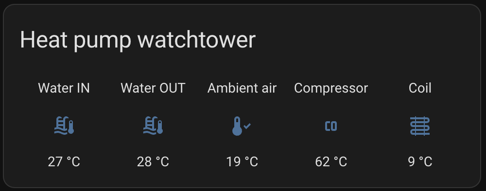

# ESP8266 Poolex Heatpump — RS485 Sniffer to MQTT

Reverse-engineering project for the RS485 protocol of a **Poolex Jetline Selection 90** heat pump (also works on the 95).

The Wemos D1 Mini passively listens to the RS485 bus between the heat pump motherboard (PAC) and the wired remote control, decodes the frames, and publishes the values to MQTT for **Home Assistant**.

## Project status

✅ Working — in production since May 2026.

**What works:**
- Temperature readings: water in/out, ambient air, coil, gas
- State readings: PAC ON/OFF, active heating (compressor)
- Reading the setpoint sent by the remote control
- Reading the setpoint confirmed by the PAC
- MQTT publishing on change + periodic republish (60s)
- OTA (Over The Air) updates
- Remote debugging via Telnet (RemoteDebug)

**What remains to be done:**
- Sending commands to the PAC (temperature setpoint, ON/OFF)
- Full decoding of the "machine state" part of the long frames
- Reading error codes

## Architecture

The whole firmware fits in a single file: **`src/main.cpp`**.

```
┌─────────────┐     RS485      ┌──────────┐     MQTT      ┌────────────────┐
│   PAC       │◄──────────────►│ Wemos D1 │──────────────►│ Home Assistant │
│   Poolex    │     (9600 8N1) │ (sniffer)│               │                │
└─────────────┘                └──────────┘               └────────────────┘
       ▲                             ▲
       │        RS485                │
       └─────────────────────────────┘
              Wired remote control
```

**Bus topology:** three devices share the same half-duplex RS485 bus:
1. The PAC motherboard
2. The original wired remote control
3. The Wemos D1 Mini (passive sniffer — never transmits)

The Wemos is wired **in parallel** with the remote control on the same harness.

## Bus protocol (Jetline 90/95)

### Characteristics
- Speed: **9600 baud, 8N1**
- Cycle: **~190 ms** (2 heartbeats per second)
- Inter-frame separator: `0x01` bytes (idle bus)
- CPU clocked at **160 MHz** for real-time processing

### Identified frame types

| Direction | Header | Size | Description |
|-----------|--------|------|-------------|
| remote → PAC | `XX 04 FF ...` | 12 B | Remote heartbeat (constant, ~98 ms) |
| PAC → remote | `FD XX ...` | 6–13 B | PAC ACK |
| PAC → remote | `[flags] <state> <sensors>` | 25–36 B | Sensors + state frame |

### Sensor decoding

The **last 9 bytes** of each long burst (≥ 25 B) contain the sensors, terminated by `FF FF`:

```cpp
water_in_temp    = ((0xFF - data[0]) >> 3) & 0x3F;  // °C
air_ambient_temp = ((0xFF - data[1]) >> 1) & 0x3F;  // °C
coil_temp        = ((0xFF - data[2]) >> 1) & 0x3F;  // °C
gas_temp         = ((0xFF - data[3]) >> 1) & 0x3F;  // °C
water_out_temp   = ((0xFF - data[4]) >> 1) & 0x3F;  // °C
// data[5] = 0xFF (constant)
active_status    = ((0xFF - data[6]) >> 4) & 0x01;  // 1 = PAC ON
// data[7-8] = FF FF (termination)
```

Validation is done by temperature range (5–45 °C) — there is no fixed header.

### Setpoint

The setpoint is extracted from two sources:
- **Remote control** (12B heartbeat): byte offset 9 → `setpoint = ((0xFF - byte) >> 1) & 0x3F`
- **PAC** (long state frame ≥15B): byte offset 2 (or 3 if FF prefix) → `setpoint_confirmed = ((0xFF - byte) >> 3) & 0x3F`

### Operating mode

The **last byte** of the long state frames (≥15B before the sensor tail) encodes the mode:

| Byte | Mode | MQTT value |
|------|------|------------|
| `0x6C` | Heating only | `heat` |
| `0x64` | Heating (variant) | `heat` |
| `0x54` | Automatic (heat + cool) | `auto` |
| `0x5C` | Cooling only | `cool` |

> ⚠️ These values come from the analysis of a single capture. `0x64` appears during transitions or after a power cycle — it is provisionally mapped to `heat`.

## Solved problem: unresponsive WiFi

### The problem

On ESP8266, **SoftwareSerial disables ALL interrupts** while receiving each byte (~1ms per byte at 9600 baud). The WiFi stack (which shares the same CPU) cannot process incoming packets → ping timeouts, OTA impossible, telnet unreachable.

Paradoxically, outgoing MQTT publishes work (they are queued), but everything that requires an incoming **response** is blocked.

### The solution

1. **Non-blocking reads**: only `PS.available()` bytes are read, never a blocking `readBytes()` with a timeout.

2. **Mini-throttle**: wait at least 5 ms between two reads (or until 20+ bytes are available) to accumulate bytes instead of reading them one by one.

3. **WiFi window during bus idle**: when the bus is inactive (between frame cycles), the SoftwareSerial RX is briefly turned off (3 ms) to let the WiFi stack process incoming packets.

```cpp
if (bus_is_idle && (now - last_wifi_window >= 50)) {
    PS.enableRx(false);
    delay(3);  // WiFi window
    PS.enableRx(true);
}
```

⚠️ **Never turn RX off during an active frame** — otherwise bytes are lost and frames get corrupted.

### Bus idle detection

The `bus_is_idle` flag becomes `true` when:
- The residual buffer is empty (all bursts have been processed)
- Only `0x01` bytes (separators) remain
- No new data for > 100 ms (residual timeout)

## Hardware

### Components
- **Wemos D1 Mini** (ESP8266)
- **MAX485** — RS485 interface
- **12V → 5V converter** (min 2A)
- WiFi coverage at the PAC location
- IP67 enclosure

### Wiring

#### PAC → MAX485
The PAC cable has 4 wires:
- **Green + Yellow**: RS485 bus → A and B of the MAX485
- **Black + Red**: 12V power supply

#### MAX485 → Wemos D1 Mini

| MAX485 pin | Wemos GPIO | Wemos pin | Function |
|------------|------------|-----------|----------|
| RO (output) | GPIO4     | D2        | RX data |
| DI (input)  | GPIO5     | D1        | TX data |
| DE + RE     | GPIO14    | D5        | Direction control |

⚠️ **DO NOT use GPIO2 (D4)** for DE/RE — this pin is HIGH at boot (ESP8266 strapping pin), which would briefly enable the transmitter and corrupt the bus.

DE/RE are tied together and kept **LOW permanently** (receive-only mode).

### Power supply
- First flash: via the computer's USB
- In operation: 12V supply from the PAC → 12V/5V converter → Wemos (5V pin) + MAX485 (VCC)

## Installation

### Prerequisites
- [PlatformIO](https://platformio.org/platformio-ide) (VSCode or CLI)

### Initial configuration

```bash
# Copy the secrets file
cp src/secrets.h.sample include/secrets.h
# Edit it with your WiFi and MQTT settings
```

Fill in `include/secrets.h`:
- `WIFI_SSID`
- `WIFI_PASSWORD`
- `MQTT_BROKER_ADDR`

### Build and flash

```bash
# Build
pio run

# Flash via USB (first flash)
pio run -t upload

# Flash via OTA (after the first flash)
pio run -t upload --upload-port 10.0.0.72
```

### Remote debugging

```bash
telnet <WEMOS_IP>
```

Use the RemoteDebug commands to change the log level (verbose, debug, info, warning, error).

## MQTT topics

### Published values (read)

| Topic | Description | Unit |
|-------|-------------|------|
| `poolheater/values/water_in_temp` | Water inlet temperature | °C |
| `poolheater/values/water_out_temp` | Water outlet temperature | °C |
| `poolheater/values/air_ambient_temp` | Ambient air temperature | °C |
| `poolheater/values/coil_temp` | Coil temperature | °C |
| `poolheater/values/gaz_temp` | Gas temperature | °C |
| `poolheater/values/active_status` | PAC powered on | 0/1 |
| `poolheater/values/heating` | Compressor active | 0/1 |
| `poolheater/values/setpoint` | Requested setpoint (remote control) | °C |
| `poolheater/values/setpoint_confirmed` | Setpoint confirmed (PAC) | °C |
| `poolheater/values/mode` | Operating mode | `heat` / `auto` / `cool` |
| `poolheater/values/error` | PAC error code (⚠️ disabled — being calibrated) | `none` |
| `poolheater/values/state_raw` | Raw state frame (hex) | For analysis |
| `poolheater/status` | Connection state (retained) | ON |

### Commands (write)

| Topic | Description |
|-------|-------------|
| `poolheater/command/probe` | Triggers a TX test transmission (experimental) |

### Publishing strategy
- Publish on **value change** (no flooding)
- **Full republish every 60 seconds** to guarantee freshness in HA
- MQTT reconnection throttled to 5 seconds between attempts

## Home Assistant integration

In your `configuration.yaml`:

```yaml
mqtt:
  sensor:
    - name: "Pool water temperature"
      state_topic: "poolheater/values/water_in_temp"
      force_update: true
      unit_of_measurement: "°C"
      unique_id: "pool_hp_water_in_temp"
      device_class: "temperature"

    - name: "Pool water OUT temperature"
      state_topic: "poolheater/values/water_out_temp"
      force_update: true
      unit_of_measurement: "°C"
      unique_id: "pool_hp_water_out_temp"
      device_class: "temperature"

    - name: "Heat pump status"
      state_topic: "poolheater/values/active_status"
      force_update: true
      unique_id: "pool_hp_status"

    - name: "Heat pump heating"
      state_topic: "poolheater/values/heating"
      force_update: true
      unique_id: "pool_hp_heating"

    - name: "Heat pump ambient air temperature"
      state_topic: "poolheater/values/air_ambient_temp"
      force_update: true
      unit_of_measurement: "°C"
      unique_id: "pool_hp_air_temp"
      device_class: "temperature"

    - name: "Heat pump gas temperature"
      state_topic: "poolheater/values/gaz_temp"
      force_update: true
      unit_of_measurement: "°C"
      unique_id: "pool_hp_gas_temp"
      device_class: "temperature"

    - name: "Heat pump coil temperature"
      state_topic: "poolheater/values/coil_temp"
      force_update: true
      unit_of_measurement: "°C"
      unique_id: "pool_hp_coil_temp"
      device_class: "temperature"

    - name: "Heat pump setpoint"
      state_topic: "poolheater/values/setpoint"
      force_update: true
      unit_of_measurement: "°C"
      unique_id: "pool_hp_setpoint"
      device_class: "temperature"

    - name: "Heat pump setpoint confirmed"
      state_topic: "poolheater/values/setpoint_confirmed"
      force_update: true
      unit_of_measurement: "°C"
      unique_id: "pool_hp_setpoint_confirmed"
      device_class: "temperature"

    - name: "Heat pump mode"
      state_topic: "poolheater/values/mode"
      force_update: true
      unique_id: "pool_hp_mode"

    - name: "Heat pump error"
      state_topic: "poolheater/values/error"
      force_update: true
      unique_id: "pool_hp_error"
      icon: "mdi:alert-circle"
```

### Mode values

| MQTT value | Mode | Description |
|------------|------|-------------|
| `heat` | Heating only | Mode 2 — the PAC only heats |
| `auto` | Automatic | Mode 1 — heating + cooling |
| `cool` | Cooling only | Mode 0 — the PAC only cools |



## Efficiency calculation (COP and thermal power)

To visualise the PAC efficiency in Home Assistant, **template sensors** are used to compute:
- **Delta T**: difference between water_out and water_in (°C)
- **Thermal power**: P = flow rate × ΔT × 1.163 (kW)
- **Estimated COP**: based on the Poolex Jetline 90 manufacturer curve as a function of air temperature

### Home Assistant configuration

Add to `configuration.yaml`:

```yaml
# --- Input number for the PAC flow rate ---
input_number:
  pool_hp_flow_rate:
    name: "PAC flow rate (m³/h)"
    min: 1
    max: 6
    step: 0.1
    initial: 3
    unit_of_measurement: "m³/h"
    icon: mdi:water-pump

# --- Template sensors for efficiency ---
template:
  - sensor:
      - name: "Pool HP Delta T"
        unique_id: "pool_hp_delta_t"
        unit_of_measurement: "°C"
        device_class: "temperature"
        state: >
          
          
          
            {{ (t_out - t_in) | round(1) }}
          
            unknown
          

      - name: "Pool HP Thermal power"
        unique_id: "pool_hp_thermal_power"
        unit_of_measurement: "kW"
        device_class: "power"
        state: >
          
          
          
          
          
            {{ (flow * delta * 1.163) | round(2) }}
          
            0
          

      - name: "Pool HP Estimated COP"
        unique_id: "pool_hp_cop_estimated"
        unit_of_measurement: "COP"
        icon: mdi:lightning-bolt-circle
        state: >
          {# Estimated COP for the Poolex Jetline 90 based on air temperature #}
          {# Approximated manufacturer curve: COP ≈ 3.0 + (T_air - 15) × 0.15 #}
          {# Clamped between 2.5 and 7.0 #}
          
          
          
            
            {{ [2.5, [cop, 7.0] | min] | max | round(1) }}
          
            unknown
          

      - name: "Pool HP Estimated electrical power"
        unique_id: "pool_hp_electrical_power"
        unit_of_measurement: "kW"
        device_class: "power"
        state: >
          
          
          
            {{ (thermal / cop) | round(2) }}
          
            0
          
```

### Notes on the COP

The COP curve is **approximated** from the Jetline Selection 90 manufacturer data:

| Air temp. | Estimated COP | Thermal power |
|-----------|---------------|---------------|
| 10°C | ~2.3 | ~5.5 kW |
| 15°C | ~3.0 | ~7.0 kW |
| 20°C | ~3.8 | ~8.5 kW |
| 26°C | ~4.6 | ~9.5 kW |
| 30°C | ~5.3 | ~10 kW |

> ⚠️ The real COP also depends on water temperature and humidity. For an accurate COP, you would need an electricity meter (e.g. a Shelly 1PM) on the PAC power supply.

> 💡 **PAC flow rate**: adjust `input_number.pool_hp_flow_rate` to match your installation. The Poolex Jetline 90 recommends 1.5–3.5 m³/h through the exchanger (not the total flow of the filtration pump).

## Frame log files

The `src/frame_logs/` directory contains raw UART bus captures for reverse-engineering:
- Captures with remote control + PAC (12–36 B frames)
- `motherboard_only.txt`: PAC alone without the remote control (93 B frames starting with `0x0C`)

## References

- Starting point: [esp8266_poolstar](https://github.com/cribskip/esp8266_poolstar)
- Protocol discussion: [Cyril's issue](https://github.com/cribskip/esp8266_poolstar/issues/2)
- [Python version](https://github.com/cyrilpawelko/poolstarmon/tree/main/micropython)
- [Jeedom Modbus thread](https://community.jeedom.com/t/domotiser-pac-inverter-de-piscine-irrijardin-warmpool-aide-connection-rs485/42440/77?page=5)
- Hayward reverse-engineering: [Arduino forum](https://forum.arduino.cc/t/resolu-reverse-engineering-protocole-thermopompe-hayward/249705)
- Poolex Dreamline reverse-engineering: [Repository](https://github.com/CDX-24/PoolexDreamlineController/tree/main)

## Contributing

Pull requests are welcome. For major changes, please open an issue first.

## License

[MIT](https://choosealicense.com/licenses/mit/)
